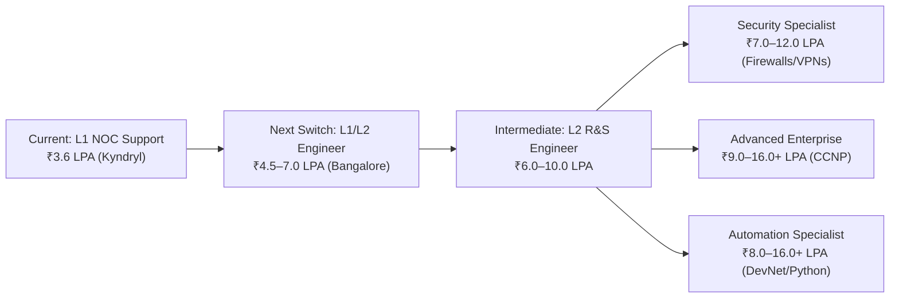

# 🚀 Network Engineer Career Roadmap — Bangalore Market Path

> **Current Role:** L1 Network Support Engineer (Kyndryl) • **Current CTC:** ₹3.6 LPA  
> **Immediate Target:** L1/L2 Network Engineer in Bangalore • **Target CTC:** ₹4.5–7.0 LPA  
> **Long-Term Trajectory:** Senior Enterprise / Security / Automation Engineer • **Target CTC:** ₹9–16+ LPA  
> **Primary Hub:** Bangalore (Manyata, Electronic City, Whitefield, Bellandur / Outer Ring Road)  
> **Interactive Dashboard:** [https://shaikmdnisaar.github.io/kyndryl-l1-mastery/](https://shaikmdnisaar.github.io/kyndryl-l1-mastery/)

---

## 1. Executive Career Strategy: The ₹3.6L to ₹16L+ Trajectory

Your most strategic approach to maximize your market value in Bangalore is **staged progression**:
1. **Solidify Fundamentals & CCNA (Now):** Master IP addressing, mental subnetting, switching, routing, and non-disruptive triage.
2. **First Company Switch (₹4.5–7.0 LPA):** Leverage your Kyndryl NOC experience + CCNA + Packet Tracer & Wireshark triage skills to secure an L1/L2 role in Bangalore.
3. **Specialize for Rapid Hikes (₹7–16+ LPA):** Choose one high-demand specialization — Network Security (Firewalls/VPNs), Enterprise CCNP (ENCOR/ENARSI), or Network Automation (Python/DevNet).

---

## 2. Salary Growth & Bangalore Market Demand Matrix

*Note: These are illustrative Bangalore market compensation benchmarks based on typical tech park hiring trends (Manyata, Ecospace, Bagmane, Electronic City). Actual offers depend on interview performance, hands-on lab depth, and company tier.*

| Career Stage | Primary Skill Profile | Illustrative Annual CTC | Target Companies in Bangalore |
| :--- | :--- | :---: | :--- |
| **Current Role** | L1 Network Support, basic monitoring, ticket dispatch | **₹3.6 LPA** | Kyndryl, entry-level MSPs |
| **Next Switch (Target #1)** | **CCNA 200-301 + Packet Tracer labs + Wireshark triage** | **₹4.5–7.0 LPA** | Wipro, Infosys, TCS, HCL, Mindtree, Tech Mahindra, NTT Data |
| **Intermediate** | L2 Switching & Routing, multi-vendor enterprise NOC, HSRP/OSPF | **₹6.0–10.0 LPA** | Orange Business Services, DXC, Microland, CGI, Cognizant |
| **Security Specialization** | Next-Gen Firewalls (Palo Alto, Fortinet, ASA), IPsec VPNs, ZTNA | **₹7.0–12.0 LPA** | Akamai, Cloudflare, Palo Alto Networks, Fortinet, Check Point |
| **Advanced Enterprise** | CCNP Enterprise (ENCOR/ENARSI), BGP, SD-WAN, high availability | **₹9.0–16.0+ LPA** | Cisco, Juniper, Dell Technologies, HPE, VMware, Goldman Sachs |
| **Automation Specialization** | Python (Netmiko/NAPALM), REST APIs, Ansible, Git, DevNet | **₹8.0–16.0+ LPA** | Amazon, Microsoft, Cisco, Arista, Morgan Stanley, Target India |

---

## 3. The 5-Phase Structured Learning Roadmap

### 🟢 Phase 1 — Networking Fundamentals
> **Timeline:** Weeks 1–3 • **Urgency:** Start Here  
> **Primary Goal:** Flawless grasp of OSI layers, TCP/UDP, mental subnetting, and packet headers.

* **Target Skills:** OSI and TCP/IP models, IPv4, Subnetting (/24 to /30), DNS, DHCP, TCP vs UDP.
* **Curated Courses (LinkedIn Learning via TPL):**
  1. [Networking Foundations: Networking Basics](https://www.linkedin.com/learning/search?keywords=Networking+Foundations+Networking+Basics&u=76281980)
  2. [Learning IP Addressing](https://www.linkedin.com/learning/search?keywords=Learning+IP+Addressing&u=76281980)
  3. [Learning Subnetting](https://www.linkedin.com/learning/search?keywords=Learning+Subnetting&u=76281980)
  4. [Cisco Networking Foundations: IP Addressing](https://www.linkedin.com/learning/search?keywords=Cisco+Networking+Foundations+IP+Addressing&u=76281980)
* **Hands-on Milestone:** Score a 10-question streak on the [Subnetting Speed Trainer](https://shaikmdnisaar.github.io/kyndryl-l1-mastery/) in under 60 seconds.

---

### 🟡 Phase 2 — Cisco Networking & CCNA
> **Timeline:** Weeks 4–10 • **Urgency:** Highest Priority  
> **Primary Goal:** Clear CCNA 200-301 concepts and build 3 end-to-end Packet Tracer topologies.

* **Target Skills:** VLANs, 802.1Q trunking, STP/RSTP, Inter-VLAN routing (ROAS & SVIs), Static routing, OSPFv2 single/multi-area, ACLs, and NAT/PAT.
* **Curated Courses:**
  1. [Cisco Networking Foundations: Fundamentals of Cisco Networking](https://www.linkedin.com/learning/search?keywords=Cisco+Networking+Foundations+Fundamentals+of+Cisco+Networking&u=76281980)
  2. [Cisco Networking Foundations: Switching and Routing](https://www.linkedin.com/learning/search?keywords=Cisco+Networking+Foundations+Switching+and+Routing&u=76281980)
  3. [Cisco Networking Foundations: Wireless Networks, Services, Security, and Virtualization](https://www.linkedin.com/learning/search?keywords=Cisco+Networking+Foundations+Wireless+Networks+Services+Security+Virtualization&u=76281980)
  4. [Wireless Networking Essential Training](https://www.linkedin.com/learning/search?keywords=Wireless+Networking+Essential+Training&u=76281980)
  5. [Cisco Certified Network Associate (CCNA 200-301) v1.1 Cert Prep by Kevin Wallace](https://www.linkedin.com/learning/cisco-certified-network-associate-ccna-v1-1-200-301-cert-prep/diving-into-the-course?u=76281980) *(201 Lessons • Direct Links in Dashboard)*
* **Hands-on Milestone:** Build a 3-switch, 2-router Packet Tracer lab featuring VLANs 10/20/30, HSRP default gateway, OSPF dynamic routing, and NAT Overload to the internet.

---

### 🟠 Phase 3 — Network Security Specialization
> **Timeline:** Months 3–4  
> **Primary Goal:** Master perimeter filtering, stateful firewalls, and secure site-to-site tunnels.

* **Target Skills:** Standard/Extended ACLs, Next-Gen Firewall architecture, IPsec VPNs, switch port hardening (Port Security, BPDU Guard, DHCP Snooping, DAI), security monitoring, and incident response.
* **Curated Courses:**
  1. [Cisco Certified Support Technician (CCST) Cybersecurity Cert Prep](https://www.linkedin.com/learning/search?keywords=Cisco+Certified+Support+Technician+CCST+Cybersecurity+Cert+Prep&u=76281980)
  2. [CCNA Cybersecurity / Cisco CyberOps Associate Cert Prep](https://www.linkedin.com/learning/search?keywords=CCNA+Cybersecurity+Cert+Prep&u=76281980)
* **Hands-on Milestone:** Simulate a perimeter firewall (Cisco ASA / Fortinet) with Inside, Outside, and DMZ zones, blocking unapproved inbound traffic and verifying stateful NAT inspection.

---

### 🟣 Phase 4 — Advanced Enterprise Networking
> **Timeline:** Months 5–8 (or after securing your next switch)  
> **Primary Goal:** Prepare for L2/L3 Senior NOC roles and enterprise network design.

* **Target Skills:** Advanced BGP multi-homing, OSPF tuning, VRFs, SD-WAN concepts, QoS traffic shaping, high availability architectures, and Sev-1 incident war rooms.
* **Curated Courses:**
  1. [Cisco CCNP Enterprise: ENCOR (350-401) Cert Prep](https://www.linkedin.com/learning/search?keywords=Cisco+CCNP+Enterprise+ENCOR+350-401+Cert+Prep&u=76281980)
  2. [Cisco CCNP Enterprise: ENARSI (300-410) Cert Prep](https://www.linkedin.com/learning/search?keywords=Cisco+CCNP+Enterprise+ENARSI+300-410+Cert+Prep&u=76281980)
* **Hands-on Milestone:** Troubleshoot route redistribution, BGP path manipulation (Weight, Local Preference, AS-Path prepending), and dual-homed ISP failover scenarios.

---

### 🔵 Phase 5 — Network Automation & Programmability
> **Timeline:** Months 6–10 (or continuous)  
> **Primary Goal:** Automate repetitive NOC operations to unlock top-tier ₹12–16+ LPA packages.

* **Target Skills:** Python for network engineers, Netmiko/NAPALM SSH automation, REST APIs, JSON/YAML parsing, Git version control, and Ansible playbooks.
* **Curated Courses:**
  1. [Cisco Certified DevNet Associate DEVASC (200-901) Cert Prep](https://www.linkedin.com/learning/search?keywords=Cisco+Certified+DevNet+Associate+DEVASC+200-901+Cert+Prep&u=76281980)
* **Hands-on Milestone:** Write a Python script that connects to 5 Cisco switches concurrently, extracts `show version` and `show interfaces status`, and exports an automated audit spreadsheet.

---

## 4. Ranked Skill Prioritization Matrix

Focus your energy where the return on investment (ROI) for Bangalore job offers is highest:

| Priority Rank | Skill or Certification | Why It Matters for Bangalore Recruiters | Immediate Focus |
| :---: | :--- | :--- | :---: |
| **1** | **IP Addressing & Mental Subnetting** | The filter question in 95% of L1/L2 technical rounds. Zero hesitation allowed. | **P0 (Daily)** |
| **2** | **CCNA 200-301 Core Topics** | The gold-standard baseline that validates you above entry-level ticket dispatchers. | **P0 (Weeks 4–10)** |
| **3** | **Wireshark & Packet Triage** | Demonstrates deep diagnostic capability (TCP 3-way handshake, RST flags, ARP drops). | **P1 (Weeks 6–10)** |
| **4** | **Routing & Switching Packet Tracer Labs** | Gives you tangible project stories to narrate in behavioral and technical interviews. | **P1 (Ongoing)** |
| **5** | **Firewalls, IPsec VPNs & Security** | Adds an instant ₹1.5–2.5 LPA premium over pure routing/switching profiles. | **P2 (Month 3+)** |
| **6** | **CCNP Enterprise (ENCOR/ENARSI)** | Opens doors to Tier-1 product companies (Cisco, Juniper, Akamai) after 2-3 years. | **P3 (Post-Switch)** |
| **7** | **Python & Network Automation** | Future-proofs your career and enables lateral movement into NetDevOps roles. | **P3 (Month 6+)** |

---

## 5. Daily 90–120 Minute Execution Schedule

Consistent daily execution alongside your Kyndryl shift is what separates top engineers:

| Day of Week | Primary Focus Area | Concrete Deliverable |
| :--- | :--- | :--- |
| **Monday** | **Networking Theory** | Watch 2 CCNA video lessons, take bullet notes on architecture & RFCs. |
| **Tuesday** | **IP Addressing & Subnetting** | Run 10 consecutive drills on the Subnetting Speed Trainer. |
| **Wednesday** | **Cisco IOS CLI & Config** | Practice commands on the Interactive Multi-Device Terminal Simulator. |
| **Thursday** | **Packet Tracer Lab Practice** | Configure 1 complete topology from scratch (VLANs, Trunks, OSPF). |
| **Friday** | **Wireshark & Troubleshooting** | Inspect a PCAP file; trace TCP handshakes, DNS queries, and ARP requests. |
| **Saturday** | **War Room & Interview Drills** | Review 1 Kyndryl Incident Playbook; rehearse 3 interview Q&As out loud. |
| **Sunday** | **Revision & Mock Testing** | Review weekly notes, take a 25-question quiz, update shift worklogs. |

---

## 6. Immediate 7-Step Action Plan

- [ ] **Step 1:** Complete Phase 1 Networking Fundamentals (IP addressing, subnetting, OSI model).
- [ ] **Step 2:** Fast-track the 66 Kyndryl Priority CCNA lessons in the Course Tracker.
- [ ] **Step 3:** Build 3 core Packet Tracer labs (Campus Switching, Inter-VLAN SVI, Multi-Area OSPF).
- [ ] **Step 4:** Analyze 5 common Wireshark capture files (TCP resets, DHCP DORA, ARP spoofing).
- [ ] **Step 5:** Write 3 showcase project summaries for your resume detailing problem, diagnosis, and resolution.
- [ ] **Step 6:** Update LinkedIn & Naukri profiles highlighting: `CCNA`, `Cisco Catalyst 9300/9200`, `OSPF`, `HSRP`, `Wireshark`, `NOC Triage`.
- [ ] **Step 7:** Begin active job applications targeting ₹4.5–7.0 LPA Bangalore L1/L2 openings once Phase 2 is complete.
