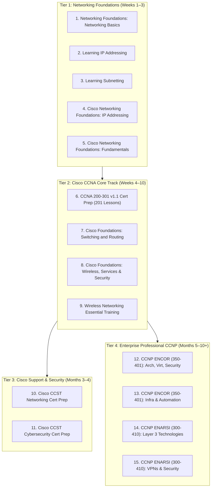

# 📚 Kevin Wallace 15-Course LinkedIn Learning Master Catalog

> **Instructor:** Kevin Wallace (Double CCIE #7945 Emeritus — Enterprise Infrastructure & Collaboration)  
> **Platform:** LinkedIn Learning (Authenticated via Toronto Public Library SSO: `?u=76281980`)  
> **Target Audience:** Network Engineers growing from L1 NOC (₹3.6 LPA) to CCNA (₹4.5–7 LPA) and CCNP Enterprise (₹9–16+ LPA)  
> **Live Web Platform:** [https://shaikmdnisaar.github.io/kyndryl-l1-mastery/](https://shaikmdnisaar.github.io/kyndryl-l1-mastery/)

---

## 🧭 Master Course Curriculum Structure & Overview

---

## 📖 Detailed Syllabi & Course Outlines

### 1. Networking Foundations: Networking Basics
* **Tier:** Foundational • **Timeline:** Weeks 1–2  
* **Direct Watch Link:** [Open Course on LinkedIn Learning](https://www.linkedin.com/learning/search?keywords=Networking+Foundations+Networking+Basics&u=76281980)  
* **Course Structure & Modules:**
  * **Module 1: Exploring Network Types & Topologies:** LAN, WAN, MAN, WLAN, PAN, Star, Mesh, Hybrid topologies.
  * **Module 2: Network Media & Hardware Components:** Copper UTP (Cat 5e/6), single-mode/multi-mode fiber optics, transceivers (SFP/SFP+), switches, routers, access points.
  * **Module 3: OSI & TCP/IP Reference Models:** 7-layer OSI model functions, protocol data units (PDUs: Frame, Packet, Segment), TCP 3-way handshake, TCP vs UDP.
  * **Module 4: Logical Addressing & Network Protocols:** IPv4 formats, subnet mask basics, MAC addresses, ARP resolution, DNS, DHCP DORA, NTP, ICMP.
  * **Module 5: Modern Enterprise Trends:** Software-Defined Networking (SDN), Cloud networking (IaaS/PaaS), and virtualization.
* **Target Skills:** OSI Layering, TCP/UDP port mapping, physical cable identification, PDU encapsulation.

---

### 2. Learning IP Addressing
* **Tier:** Foundational • **Timeline:** Weeks 1–2  
* **Direct Watch Link:** [Open Course on LinkedIn Learning](https://www.linkedin.com/learning/search?keywords=Learning+IP+Addressing&u=76281980)  
* **Course Structure & Modules:**
  * **Module 1: IPv4 Structure & Binary Essentials:** Decimal-to-binary conversion, 32-bit address structure, network vs host bits.
  * **Module 2: Address Classes & RFC 1918 Private Ranges:** Class A, B, C, D (Multicast), E (Experimental); 10.0.0.0/8, 172.16.0.0/12, 192.168.0.0/16.
  * **Module 3: Classless Inter-Domain Routing (CIDR):** Slash notation (/8 to /32), default subnet masks, and prefix matching.
  * **Module 4: Special Use Addresses:** Loopback (127.0.0.1), APIPA (169.254.0.0/16), default route (0.0.0.0), and broadcast (255.255.255.255).
  * **Module 5: Introduction to IPv6 Addressing:** 128-bit hexadecimal format, zero compression rules, Global Unicast, Link-Local (FE80::), Unique Local.
* **Target Skills:** Decimal/binary conversion, private vs public IP classification, identifying APIPA issues.

---

### 3. Learning Subnetting
* **Tier:** Foundational • **Timeline:** Weeks 2–3  
* **Direct Watch Link:** [Open Course on LinkedIn Learning](https://www.linkedin.com/learning/search?keywords=Learning+Subnetting&u=76281980)  
* **Course Structure & Modules:**
  * **Module 1: The Mathematics of Subnetting:** Powers of 2 ($2^n$ subnets, $2^h - 2$ hosts), calculating block sizes / increments.
  * **Module 2: Subnetting Class C Networks (/24 to /30):** Point-to-point links (/30, /31), determining Network ID, First Usable, Last Usable, and Broadcast.
  * **Module 3: Subnetting Class B and Class A Networks:** Borrowing across multiple octets (/16 to /23), block size math in octet 3.
  * **Module 4: Variable Length Subnet Masking (VLSM):** Designing an efficient IP plan for multi-branch corporate networks without wasting address space.
  * **Module 5: Mental Speed Subnetting Shortcuts:** The finger method, chart-free CIDR memorization, and real-time interview calculation hacks.
* **Target Skills:** Sub-15-second subnet calculations, VLSM address allocation, broadcast boundary determination.

---

### 4. Cisco Networking Foundations: IP Addressing
* **Tier:** Foundational / Hands-on • **Timeline:** Weeks 2–3  
* **Direct Watch Link:** [Open Course on LinkedIn Learning](https://www.linkedin.com/learning/search?keywords=Cisco+Networking+Foundations+IP+Addressing&u=76281980)  
* **Course Structure & Modules:**
  * **Module 1: Cisco IOS Interface IP Configuration:** Assigning IPv4 addresses to router interfaces and Layer 2 switch management SVIs.
  * **Module 2: Secondary IP Addresses & Loopback Interfaces:** Testing routing logic and router ID stability using loopback interfaces.
  * **Module 3: IPv6 Interface Configuration:** Static IPv6 assignment, EUI-64 identifier generation, and link-local verification.
  * **Module 4: Address Verification on Cisco IOS:** Using `show ip interface brief`, `show ipv6 interface brief`, and ping/traceroute verification.
* **Target Skills:** Cisco IOS interface addressing, SVI IP assignment, loopback interfaces.

---

### 5. Cisco Networking Foundations: Fundamentals of Cisco Networking
* **Tier:** Foundational / Cisco Intro • **Timeline:** Weeks 3–4  
* **Direct Watch Link:** [Open Course on LinkedIn Learning](https://www.linkedin.com/learning/search?keywords=Cisco+Networking+Foundations+Fundamentals+of+Cisco+Networking&u=76281980)  
* **Course Structure & Modules:**
  * **Module 1: Cisco Enterprise Hardware Ecosystem:** Catalyst switches (9200, 9300), ISR routers (4000 series), ASA/Firepower security appliances.
  * **Module 2: Cisco IOS CLI Navigation:** User EXEC mode (`>`), Privileged EXEC mode (`#`), Global Configuration mode (`(config)#`), Sub-configuration modes.
  * **Module 3: Baseline Device Hardening:** Setting hostname, encrypted enable secret, console password, VTY remote access, MOTD banner, saving config (`write memory`).
  * **Module 4: Neighbor Discovery Protocols:** Configuring and troubleshooting Cisco Discovery Protocol (CDP) and Link Layer Discovery Protocol (LLDP).
* **Target Skills:** Cisco CLI hierarchy, initial switch setup, CDP neighbor mapping.

---

### 6. Cisco Certified Network Associate (CCNA 200-301) v1.1 Cert Prep (Master Course)
* **Tier:** Associate / Core Track (Highest Priority) • **Timeline:** Weeks 4–10  
* **Direct Watch Link:** [Open Course on LinkedIn Learning](https://www.linkedin.com/learning/cisco-certified-network-associate-ccna-v1-1-200-301-cert-prep/diving-into-the-course?u=76281980)  
* **Course Structure & Modules (201 Lessons • 18h 22m):**
  * **Module 1: Foundational Networking Technologies (25 Lessons):** Routers, switches, firewalls, spine-leaf, cabling, TCP vs UDP.
  * **Module 2: IPv4 Addressing & Subnetting (21 Lessons):** Binary conversions, CIDR, VLSM, practice drills.
  * **Module 3: IPv6 Addressing (17 Lessons):** IPv6 format, address types, SLAAC, EUI-64.
  * **Module 4: Ethernet Switching (38 Lessons):** MAC tables, VLANs, 802.1Q trunks, STP states, Rapid PVST+, EtherChannel.
  * **Module 5: Routing (22 Lessons):** Static routes, floating routes, Inter-VLAN routing, OSPFv2 neighbor formation, HSRP failover.
  * **Module 6: Wireless Networks (13 Lessons):** RF bands, WLC deployment models, CAPWAP, SSIDs, CleanAir.
  * **Module 7: Network Services (23 Lessons):** DHCP DORA, NAT Overload (PAT), NTP sync, Syslog logging, SSHv2, SNMP.
  * **Module 8: Network Security (27 Lessons):** Standard/Extended ACLs, Port Security, DHCP Snooping, Dynamic ARP Inspection (DAI).
  * **Module 9: Network Programmability (10 Lessons):** SDN architecture, REST APIs, JSON parsing, Cisco Catalyst Center, Ansible.
  * **Module 10: Exam Preparation & Practice (3 Lessons):** Study strategies, time management, exam registration.
* **Target Skills:** Full CCNA 200-301 blueprint mastery, L1/L2 NOC troubleshooting.

---

### 7. Cisco Networking Foundations: Switching and Routing
* **Tier:** Associate Deep Dive • **Timeline:** Weeks 5–7  
* **Direct Watch Link:** [Open Course on LinkedIn Learning](https://www.linkedin.com/learning/search?keywords=Cisco+Networking+Foundations+Switching+and+Routing&u=76281980)  
* **Course Structure & Modules:**
  * **Module 1: Ethernet Switching Deep Dive:** Ethernet frame layout, MAC learning & aging, CAM table flooding, broadcast vs collision domains.
  * **Module 2: VLANs & 802.1Q Trunking:** Access port assignments, native VLAN security, dynamic trunking protocol (DTP) risks.
  * **Module 3: Spanning Tree Protocol Operations:** Root bridge election, root port selection, designated ports, blocked ports, topology change notifications (TCN).
  * **Module 4: EtherChannel Link Aggregation:** Bundling links via LACP (802.3ad) and PAgP, load-balancing algorithms, troubleshooting misconfigurations.
  * **Module 5: IP Routing & Packet Forwarding:** Step-by-step frame rewrite, TTL decrement, longest prefix match lookup, static routes, and legacy RIPv2/RIPng.
* **Target Skills:** Layer 2 loop resolution, VLAN trunk verification, EtherChannel load-balancing.

---

### 8. Cisco Networking Foundations: Wireless Networks, Services, Security, and Virtualization
* **Tier:** Associate Deep Dive • **Timeline:** Weeks 7–9  
* **Direct Watch Link:** [Open Course on LinkedIn Learning](https://www.linkedin.com/learning/search?keywords=Cisco+Networking+Foundations+Wireless+Networks+Services+Security+Virtualization&u=76281980)  
* **Course Structure & Modules:**
  * **Module 1: Cisco Wireless Architecture:** Autonomous vs Lightweight APs, Cisco WLC GUI & CLI navigation, CAPWAP tunnel encapsulation.
  * **Module 2: Network Infrastructure Services:** DHCP server & relay configuration on Cisco routers, NAT Overload (PAT) pool creation.
  * **Module 3: Basic Network Security & ACLs:** Standard vs Extended ACL syntax, applying ACLs to interfaces with `ip access-group`, securing VTY lines with `access-class`.
  * **Module 4: Network Virtualization & Cloud Integration:** Virtual switching, virtual routing and forwarding (VRF Lite), connecting to enterprise cloud VPCs.
* **Target Skills:** ACL filtering, DHCP relay, WLC management, VRF fundamentals.

---

### 9. Wireless Networking Essential Training
* **Tier:** Associate Specialization • **Timeline:** Weeks 8–9  
* **Direct Watch Link:** [Open Course on LinkedIn Learning](https://www.linkedin.com/learning/search?keywords=Wireless+Networking+Essential+Training&u=76281980)  
* **Course Structure & Modules:**
  * **Module 1: Radio Frequency (RF) Principles:** Decibels (dB, dBm), antennas (omnidirectional vs directional), signal attenuation, free space path loss.
  * **Module 2: 802.11 Standards Evolution:** 802.11a/b/g/n (Wi-Fi 4), 802.11ac (Wi-Fi 5), 802.11ax (Wi-Fi 6/6E), 802.11be (Wi-Fi 7).
  * **Module 3: Spectrum Management:** 2.4 GHz non-overlapping channels (1, 6, 11), 5 GHz UNII bands, DFS (Dynamic Frequency Selection), 6 GHz channels.
  * **Module 4: Wireless Security & Authentication:** WEP vulnerabilities, WPA2-Personal (PSK), WPA2-Enterprise (802.1X / RADIUS), WPA3 SAE (Simultaneous Authentication of Equals).
  * **Module 5: Troubleshooting Wireless Issues:** Co-channel interference, hidden node problem, roaming disconnects, SNR optimization.
* **Target Skills:** Enterprise Wi-Fi troubleshooting, 802.1X authentication, RF signal analysis.

---

### 10. Cisco Certified Support Technician (CCST) Networking Cert Prep
* **Tier:** Support / Entry Specialist • **Timeline:** Weeks 2–4  
* **Direct Watch Link:** [Open Course on LinkedIn Learning](https://www.linkedin.com/learning/search?keywords=Cisco+Certified+Support+Technician+CCST+Networking+Cert+Prep&u=76281980)  
* **Course Structure & Modules:**
  * **Module 1: Standards and Concepts:** Core networking definitions, topologies, network models, and bandwidth vs throughput.
  * **Module 2: Addressing & Subnet Formats:** Practical IP and MAC address notation, default gateways, and broadcast domain boundaries.
  * **Module 3: Endpoints and Media Types:** Verifying Windows, Linux, and macOS network adapter properties, copper/fiber connector types (RJ-45, LC, SC).
  * **Module 4: Infrastructure Diagnostics:** Using basic diagnostic utilities (`ipconfig`, `ifconfig`, `ping`, `tracert`, `nslookup`, `arp -a`, `netstat`).
  * **Module 5: Structured Troubleshooting Methodology:** 7-step network troubleshooting approach, gathering customer symptoms, isolating fault domains.
* **Target Skills:** First-call ticket resolution, physical layer connectivity checks, diagnostic command execution.

---

### 11. Cisco Certified Support Technician (CCST) Cybersecurity Cert Prep
* **Tier:** Security Support • **Timeline:** Months 3–4  
* **Direct Watch Link:** [Open Course on LinkedIn Learning](https://www.linkedin.com/learning/search?keywords=Cisco+Certified+Support+Technician+CCST+Cybersecurity+Cert+Prep&u=76281980)  
* **Course Structure & Modules:**
  * **Module 1: Security Principles:** CIA triad (Confidentiality, Integrity, Availability), authentication vs authorization, least privilege.
  * **Module 2: Threat Landscape:** Malware (viruses, worms, ransomware), social engineering (phishing, vishing), man-in-the-middle, DDoS attacks.
  * **Module 3: Network Defense Fundamentals:** Firewalls (packet filtering, stateful inspection, application-level), DMZ architecture, IDS/IPS sensors.
  * **Module 4: Endpoint Security & Access Management:** Multi-factor authentication (MFA), password policies, certificate-based authentication, VPN tunnels.
  * **Module 5: Incident Handling & Compliance:** Security event logging, SIEM alerts, incident response phases (preparation, detection, containment, eradication, recovery).
* **Target Skills:** Cybersecurity fundamentals, incident containment, firewall zone basics.

---

### 12. Cisco CCNP Enterprise: ENCOR (350-401) Cert Prep: 1 Architecture, Virtualization, Network Assurance, and Security
* **Tier:** Professional Enterprise • **Timeline:** Months 5–7  
* **Direct Watch Link:** [Open Course on LinkedIn Learning](https://www.linkedin.com/learning/search?keywords=Cisco+CCNP+Enterprise+ENCOR+350-401+Cert+Prep+1&u=76281980)  
* **Course Structure & Modules:**
  * **Module 1: Enterprise Campus Architecture:** 2-tier vs 3-tier hierarchical design, high-availability clusters, Spine-Leaf data center architecture.
  * **Module 2: Cisco Software-Defined Access (SD-Access):** Overlay vs underlay networks, LISP control plane, VXLAN data plane, Cisco Catalyst Center fabric roles.
  * **Module 3: Cisco SD-WAN Architecture:** vManage, vSmart, vBond, and vEdge components; automated zero-touch provisioning and IPsec data plane.
  * **Module 4: Network Virtualization:** Hypervisors, Virtual Machine (VM) networking, Virtual Network Functions (VNF), and VRF-Lite segmentation.
  * **Module 5: Network Assurance & Telemetry:** NetFlow / IPFIX, SPAN / RSPAN / ERSPAN port mirroring, IP SLA proactive monitoring, streaming telemetry.
  * **Module 6: Enterprise Security Hardening:** Cisco TrustSec (Security Group Tags - SGT), 802.1X with Cisco ISE, MACsec link encryption, CoPP (Control Plane Policing).
* **Target Skills:** SD-WAN/SD-Access concepts, enterprise campus design, telemetry monitoring, 802.1X ISE.

---

### 13. Cisco CCNP Enterprise: ENCOR (350-401) Cert Prep: 2 Infrastructure and Automation
* **Tier:** Professional Enterprise • **Timeline:** Months 6–8  
* **Direct Watch Link:** [Open Course on LinkedIn Learning](https://www.linkedin.com/learning/search?keywords=Cisco+CCNP+Enterprise+ENCOR+350-401+Cert+Prep+2&u=76281980)  
* **Course Structure & Modules:**
  * **Module 1: Advanced Layer 2 Switching:** Multiple Spanning Tree (MSTP), Spanning Tree toolkit (Root Guard, Loop Guard, BPDU Filtering), port channels.
  * **Module 2: Advanced OSPFv2 and OSPFv3:** Multi-area design, LSA types (1, 2, 3, 4, 5, 7), Stub/NSSA areas, path selection, summarization.
  * **Module 3: Enterprise BGP Routing:** External BGP (eBGP) peering, loopback peering, path attributes (Weight, Local Pref, AS-Path, MED), route reflectors.
  * **Module 4: Network Redundancy & IP Services:** VRRPv3, GLBP, bidirectional forwarding detection (BFD) for sub-second failover.
  * **Module 5: Network Automation & Programmability:** Python scripting with Netmiko, REST APIs (HTTP verbs, JSON parsing), YANG data models, NETCONF / RESTCONF.
* **Target Skills:** BGP path selection, OSPF multi-area tuning, MSTP, Python network scripting.

---

### 14. Cisco CCNP Enterprise: ENARSI (300-410) Cert Prep: Layer 3 Technologies
* **Tier:** Advanced Routing Specialist • **Timeline:** Months 7–9  
* **Direct Watch Link:** [Open Course on LinkedIn Learning](https://www.linkedin.com/learning/search?keywords=Cisco+CCNP+Enterprise+ENARSI+300-410+Cert+Prep+Layer+3&u=76281980)  
* **Course Structure & Modules:**
  * **Module 1: Complex IPv4 and IPv6 Routing:** EIGRP named mode, unequal-cost load balancing, OSPF area types and virtual links.
  * **Module 2: Advanced Route Redistribution:** Mutual route redistribution between OSPF and BGP, preventing routing loops using route tagging and administrative distance adjustment.
  * **Module 3: Route Filtering & Policy-Based Routing (PBR):** Prefix lists, route maps, match/set clauses, overriding routing tables with PBR.
  * **Module 4: Deep-Dive BGP Operations:** BGP community attributes, multi-homed customer routing, conditional route advertisement, soft reconfiguration.
* **Target Skills:** Complex route redistribution, policy-based routing, multi-homed ISP BGP routing.

---

### 15. Cisco CCNP Enterprise: ENARSI (300-410) Cert Prep: VPN Technologies and Infrastructure Security
* **Tier:** Advanced Security Specialist • **Timeline:** Months 8–10+  
* **Direct Watch Link:** [Open Course on LinkedIn Learning](https://www.linkedin.com/learning/search?keywords=Cisco+CCNP+Enterprise+ENARSI+300-410+Cert+Prep+VPN&u=76281980)  
* **Course Structure & Modules:**
  * **Module 1: Enterprise VPN Technologies:** Dynamic Multipoint VPN (DMVPN Phase 1, Phase 2, Phase 3), mGRE, NHRP, IPsec tunnel protection.
  * **Module 2: MPLS Layer 3 VPN Fundamentals:** Provider (P), Provider Edge (PE), and Customer Edge (CE) roles; Route Distinguishers (RD) and Route Targets (RT).
  * **Module 3: Infrastructure Security & CoPP:** Control Plane Policing (CoPP) rate limiting, protecting the router CPU against DoS attacks.
  * **Module 4: Enterprise Device Hardening:** TACACS+ and RADIUS AAA server integration, SSH key-exchange security, securing SNMPv3 with authPriv encryption.
* **Target Skills:** DMVPN site-to-site configuration, MPLS L3VPN concepts, CoPP CPU protection, enterprise AAA.

---

## 📊 Summary Reference Matrix

| # | Course Title | Level | Duration | Primary Cert Track | Salary Impact in Bangalore |
| :-: | :--- | :---: | :---: | :---: | :---: |
| **1** | Networking Foundations: Networking Basics | Foundations | ~2h 15m | Network+ / CCNA | Essential baseline |
| **2** | Learning IP Addressing | Foundations | ~1h 45m | CCNA / Network+ | Essential baseline |
| **3** | Learning Subnetting | Foundations | ~1h 30m | CCNA / NOC | **P0 for ₹4.5–7L switch** |
| **4** | Cisco Networking Foundations: IP Addressing | Foundations | ~1h 15m | CCNA Cisco IOS | High practical value |
| **5** | Cisco Networking Foundations: Fundamentals | Foundations | ~2h 00m | CCNA / L1 NOC | Day-1 CLI navigation |
| **6** | **Cisco CCNA (200-301) v1.1 Cert Prep (Master)** | **Associate** | **18h 22m** | **CCNA 200-301** | **Primary target: ₹4.5–7L CTC** |
| **7** | Cisco Foundations: Switching and Routing | Associate | ~3h 30m | CCNA R&S | L2/L3 core competency |
| **8** | Cisco Foundations: Wireless, Services, Security | Associate | ~2h 45m | CCNA Services | Service triage (DHCP/NAT) |
| **9** | Wireless Networking Essential Training | Associate | ~2h 10m | CCNA / CWNA | Enterprise Wi-Fi triage |
| **10** | Cisco CCST Networking Cert Prep | Support | ~2h 30m | Cisco CCST | First-line ticket resolution |
| **11** | Cisco CCST Cybersecurity Cert Prep | Security | ~2h 45m | Cisco CCST Cyber | Entry to security ops |
| **12** | Cisco CCNP ENCOR: Arch, Virt, Security (Part 1) | Professional | ~4h 15m | CCNP ENCOR | Step to **₹9–16+ LPA** |
| **13** | Cisco CCNP ENCOR: Infra & Automation (Part 2) | Professional | ~4h 45m | CCNP ENCOR | Advanced BGP/Automation |
| **14** | Cisco CCNP ENARSI: Layer 3 Technologies | Professional | ~5h 00m | CCNP ENARSI | Senior L3 Escalation |
| **15** | Cisco CCNP ENARSI: VPN Technologies & Security | Professional | ~4h 30m | CCNP ENARSI | Enterprise DMVPN/MPLS |
