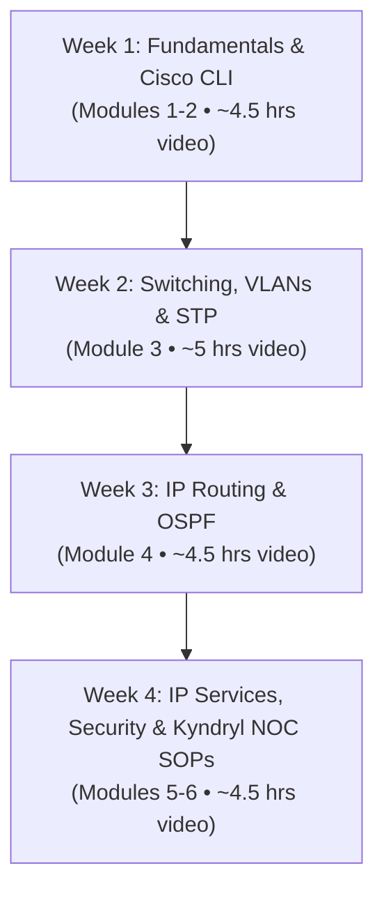

# Kyndryl L1 Network Support Engineer — CCNA v1.1 Study & Preparation Plan

> **Target Role:** L1 Network Engineer / Associate Network Operations Center (NOC) Specialist  
> **Target Employer:** Kyndryl (Enterprise Infrastructure & Managed Network Services)  
> **Primary Resource:** *Cisco Certified Network Associate (CCNA) v1.1 (200-301) Cert Prep* by Kevin Wallace (LinkedIn Learning — 18h 22m)  
> **Course Duration:** 18 Hours 22 Minutes (Video Content) + ~25 Hours of Hands-on Labs & Quizzes  

---

## 1. Role Context: What Kyndryl Expects from an L1 Network Engineer

At Kyndryl, an **L1 Network Engineer (NOC / Operations)** is the first line of defense managing complex enterprise client networks across global data centers, campuses, and hybrid cloud environments.

### Primary Day-to-Day Responsibilities at Kyndryl:
1. **Alert Monitoring & Incident Triage:** Monitoring alerts generated by tools like SolarWinds, Cisco Catalyst Center (DNA Center), Splunk, and Netcool.
2. **First-Contact Diagnostics:** Running non-intrusive Cisco IOS verification commands (`show` commands, ping, traceroute) to isolate Layer 1, Layer 2, or Layer 3 faults.
3. **Common L1 Incident Resolution:**
   - Bouncing or resetting hung switch ports.
   - Diagnosing duplex / speed mismatches and CRC errors.
   - Resolving VLAN misconfigurations and port-security err-disabled states.
   - Troubleshooting DHCP lease failures, DNS issues, and default gateway unreachability.
   - Dispatching local smart hands or telecom carrier tickets for fiber/circuit cuts.
4. **Ticket Documentation & Escalation:** Following ITIL protocols in ServiceNow/Remedy; capturing comprehensive `show tech-support` logs before escalating to L2/L3 within strict client SLAs.

---

## 2. 4-Week Structured Study Roadmap

This roadmap breaks down the 18h 22m LinkedIn Learning course into a 4-week, high-impact schedule tailored specifically for Kyndryl L1 operations.



---

### Week 1: Network Fundamentals & Cisco IOS Command Line
> **Focus:** Understanding enterprise architecture and mastering Cisco IOS navigation.
* **Course Modules to Watch:**
  - *Introduction & Performing Lab Exercises*
  - *Module 1: Foundational Networking Technologies* (Routers, Switches, Security Appliances, Endpoints, Cisco Catalyst Center, Virtualization)
  - *Module 2: Network Topologies & Physical Layer* (Cables, Fiber, SFP optics, Speed/Duplex, TCP vs. UDP, IPv4/IPv6 Addressing and Subnetting)
* **Kyndryl L1 Core Competencies:**
  - Rapid subnet calculation (/24 to /30) to verify client IP configs.
  - Identifying physical cabling faults, fiber link loss, and optical power issues.
  - Distinguishing TCP handshake resets from firewall drops.
* **Hands-on Labs (Cisco Packet Tracer / CML):**
  - Lab 1.1: Connect routers and switches via console and configure hostname, banner, enable secret, and SSH access.
  - Lab 1.2: IP subnetting assignment across 3 subnets with default gateway validation.
* **Must-Know L1 Commands:**
  ```text
  show version
  show running-config | include hostname|interface
  show ip interface brief
  show interfaces status
  show cdp neighbors detail / show lldp neighbors detail
  ```

---

### Week 2: Enterprise Switching, VLANs, Trunking & Spanning Tree
> **Focus:** Resolving Layer 2 local area network (LAN) disruptions and loop prevention.
* **Course Modules to Watch:**
  - *Module 3: Network Access & LAN Switching*
    - VLAN concepts and multi-switch VLAN configurations
    - 802.1Q Trunking & Native VLAN matching
    - Spanning Tree Protocol (STP 802.1D, Rapid STP 802.1w)
    - Root Bridge election, PortFast, BPDU Guard
    - EtherChannel (LACP & PAgP bundle negotiation)
    - Wireless LAN Controllers (WLCs) and AP modes
* **Kyndryl L1 Core Competencies:**
  - Identifying broadcast storms and finding the culprit switch port.
  - Fixing trunk encapsulation and native VLAN mismatch alerts.
  - Diagnosing why a device cannot communicate across VLANs (Inter-VLAN routing / router-on-a-stick).
  - Recovering `err-disabled` ports caused by BPDU Guard or Port Security violations.
* **Hands-on Labs:**
  - Lab 2.1: Configure VLANs 10, 20, 30 and 802.1Q trunk links between 2 Cisco Catalyst switches.
  - Lab 2.2: Verify Rapid PVST+ root bridge priority and test failover when the primary root goes down.
  - Lab 2.3: Build an LACP EtherChannel (Port-Channel 1) and confirm load-balancing status.
* **Must-Know L1 Commands:**
  ```text
  show vlan brief
  show interfaces trunk
  show spanning-tree summary
  show spanning-tree vlan <vlan-id>
  show etherchannel summary
  show mac address-table dynamic
  ```

---

### Week 3: IP Connectivity, Static Routing & OSPF Operations
> **Focus:** Troubleshooting Layer 3 packet forwarding, routing tables, and WAN link drops.
* **Course Modules to Watch:**
  - *Module 4: IP Connectivity & Routing*
    - How routers make forwarding decisions (Longest Prefix Match, Administrative Distance, Metric)
    - IPv4 & IPv6 Static Routing (Default routes, Floating static routes)
    - Dynamic Routing with Open Shortest Path First (OSPFv2)
    - OSPF Neighbor Adjacency states (Down -> Init -> 2-Way -> ExStart -> Exchange -> Loading -> Full)
    - First Hop Redundancy Protocols (HSRP active/standby failover)
* **Kyndryl L1 Core Competencies:**
  - Checking if a remote client subnet exists in the routing table.
  - Troubleshooting why an OSPF neighbor relationship is stuck in `EXSTART` or `2-WAY` (MTU mismatch, area mismatch, timer mismatch, network mask mismatch).
  - Verifying HSRP virtual IP reachability during gateway failovers.
* **Hands-on Labs:**
  - Lab 3.1: Configure static and floating backup routes; verify failover by shutting down primary interfaces.
  - Lab 3.2: Configure Single-Area OSPFv2 between 3 routers and verify route propagation (`O` in routing table).
  - Lab 3.3: Configure HSRP on dual distribution switches and test VIP gateway redundancy for client hosts.
* **Must-Know L1 Commands:**
  ```text
  show ip route
  show ip route <destination-ip>
  show ip ospf neighbor
  show ip ospf interface brief
  show standby brief
  traceroute <destination-ip> source <source-ip>
  ```

---

### Week 4: IP Services, Security & Kyndryl NOC Operations Playbook
> **Focus:** Network infrastructure services, access controls, automation concepts, and incident handling.
* **Course Modules to Watch:**
  - *Module 5: IP Services* (Inside/Outside NAT & PAT, NTP synchronization, DHCP server & DHCP Relay Agent, DNS, SNMPv2c/SNMPv3, Syslog)
  - *Module 6: Security Fundamentals* (Standard/Extended ACLs, Port Security, DHCP Snooping, Dynamic ARP Inspection)
  - *Module 7: Network Automation & Programmability Overview* (REST APIs, JSON, Cisco Catalyst Center)
  - *Practice Exams Review:* Take the 3 practice exams (88 questions each) included in the course ZIP files.
* **Kyndryl L1 Core Competencies:**
  - Resolving client IP acquisition failures (`ip helper-address` on router SVI).
  - Checking NAT translation tables for exhausted PAT pools.
  - Validating ACL permit/deny hit counters to ensure traffic is not inadvertently blocked.
  - Writing professional, crisp incident updates in ticket worklogs.
* **Hands-on Labs:**
  - Lab 4.1: Configure DHCP Relay (`ip helper-address`) and verify host IP lease acquisition.
  - Lab 4.2: Configure Standard and Extended ACLs to permit web traffic while blocking Telnet/ICMP.
  - Lab 4.3: Configure Port Security with `violation shutdown` and recovery via `errdisable recovery`.
* **Must-Know L1 Commands:**
  ```text
  show ip nat translations
  show access-lists
  show ip dhcp binding
  show ntp status
  show logging
  show errdisable recovery
  ```

---

## 3. Kyndryl L1 NOC Troubleshooting Cheat Sheet

When an alert fires in Kyndryl's monitoring tools, follow this systematic diagnostic flow:

| Problem Scenario | Diagnostic Steps & Commands | Common Root Cause & L1 Fix |
| :--- | :--- | :--- |
| **Interface Down/Down** | 1. `show interface <id>`<br>2. Check line protocol status<br>3. `show cdp neighbors` | Cable unplugged, patch panel disconnect, carrier circuit fault, or remote device powered off. |
| **Interface Up/Down** | 1. `show interface <id>`<br>2. Check for keepalive errors | Layer 2 encapsulation mismatch, clock rate missing, or line framing issue. |
| **High Input Errors / CRCs** | 1. `show interface <id>`<br>2. Look for `duplex`, `speed`, and `CRC` counters | Duplex mismatch (one side Full, other Half) or damaged Ethernet/fiber patch cable. |
| **Port Err-Disabled** | 1. `show interface status err-disabled`<br>2. `show errdisable detect` | BPDU received on PortFast port, Port Security MAC limit reached, or duplex flapping. |
| **Client Cannot Reach Gateway** | 1. `show ip arp`<br>2. `show mac address-table`<br>3. Verify switch port VLAN | Access port assigned to wrong VLAN or IP address/subnet mask configured incorrectly on host. |
| **OSPF Not Forming Adjacency** | 1. `show ip ospf neighbor`<br>2. `show ip ospf interface <id>` | Area ID mismatch, Hello/Dead interval mismatch, MTU mismatch, or passive-interface configured. |

---

## 4. Kyndryl Interview Preparation: Top 10 Technical Questions

1. **What happens during the DORA process in DHCP, and why is `ip helper-address` needed?**
   * *Answer:* Discover, Offer, Request, Acknowledge. `ip helper-address` converts client broadcast DHCP Discovers into unicast UDP packets sent to the DHCP server across subnets.
2. **What is the difference between Half Duplex and Full Duplex, and what symptom occurs if they mismatch?**
   * *Answer:* Half duplex uses CSMA/CD and sends/receives sequentially; Full duplex sends and receives simultaneously. A mismatch causes severe throughput degradation, late collisions, and high CRC error counts.
3. **What is Spanning Tree Protocol (STP), and why do we use PortFast and BPDU Guard?**
   * *Answer:* STP prevents Layer 2 switching loops. PortFast immediately places access ports into forwarding mode (skipping listening/learning). BPDU Guard shuts down (`err-disable`) any PortFast port if a BPDU is detected to prevent rogue switches.
4. **How does a router choose the best path when multiple routes exist for the same destination?**
   * *Answer:* 1. Longest Prefix Match (most specific subnet mask); 2. Lowest Administrative Distance (AD); 3. Lowest Metric (cost).
5. **What are the common states of OSPF neighbor establishment?**
   * *Answer:* Down, Init, 2-Way, ExStart, Exchange, Loading, Full.
6. **Explain the difference between Static NAT, Dynamic NAT, and PAT (Port Address Translation / NAT Overload).**
   * *Answer:* Static NAT is 1-to-1 permanent mapping; Dynamic NAT is 1-to-1 from a pool; PAT maps multiple private IPs to a single public IP using unique source port numbers.
7. **What is the default Administrative Distance (AD) for Connected, Static, eBGP, OSPF, and RIP routes?**
   * *Answer:* Connected: 0, Static: 1, eBGP: 20, OSPF: 110, RIP: 120, Internal BGP: 200.
8. **What is HSRP, and what is its default virtual MAC address?**
   * *Answer:* Hot Standby Router Protocol provides first-hop gateway redundancy. Virtual MAC format for HSRP v1 is `0000.0c07.acXX` (where XX is the hexadecimal group number).
9. **How would you triage a ticket stating: "Entire sales department lost network access"?**
   * *Answer:* Check gateway switch/router status; check uplink interface status; verify STP root/topology changes; check DHCP scope exhaustion; verify recent changes or maintenance work.
10. **What is ITIL Incident Management, and what are Kyndryl's priority levels (P1 to P4)?**
    * *Answer:* P1/Sev-1 is critical business outage (requires immediate bridge call and updates every 15-30m); P2 is major degradation; P3 is moderate issue; P4 is low impact / individual user request.

---

## 5. Daily Execution Checklist

- [ ] **Days 1–7 (Week 1):** Complete Course Modules 1 & 2. Practice decimal-to-binary subnetting daily (15 mins/day).
- [ ] **Days 8–14 (Week 2):** Complete Course Module 3. Build a multi-VLAN topology with trunks and Rapid PVST+ in Packet Tracer.
- [ ] **Days 15–21 (Week 3):** Complete Course Module 4. Build an OSPF 3-router topology and simulate WAN link failovers.
- [ ] **Days 22–28 (Week 4):** Complete Course Modules 5–7. Take the 3 Kevin Wallace Practice Exams (aim for 85%+). Review Kyndryl L1 Troubleshooting Cheat Sheet.
