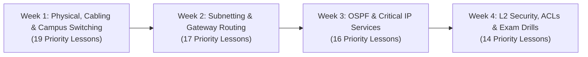

# Kyndryl L1 Network Support Engineer — Master Preparation Plan

> **Target Role:** L1 Network Engineer / Associate NOC Operations Specialist  
> **Employer:** Kyndryl (Enterprise Infrastructure & Managed Network Services)  
> **Primary Resource:** [Cisco Certified Network Associate (CCNA) v1.1 Cert Prep by Kevin Wallace](https://www.linkedin.com/learning/cisco-certified-network-associate-ccna-v1-1-200-301-cert-prep/diving-into-the-course?u=76281980)  
> **Total Course:** 201 Lessons (18h 22m) • **Kyndryl Priority Fast-Track:** 66 Core Lessons (~6h 15m)  
> **Live Interactive Tracker:** [https://shaikmdnisaar.github.io/kyndryl-l1-mastery/](https://shaikmdnisaar.github.io/kyndryl-l1-mastery/)

---

## 1. Executive Summary: What Makes You Strong at Kyndryl

At Kyndryl, an L1 Network Operations Center (NOC) engineer manages thousands of mission-critical routers, switches, and firewalls for Fortune 500 banks, airlines, and healthcare providers. 

To stand out in the interview and dominate on Day 1, you must excel at **three primary skill pillars**:
1. **Zero-Guesswork L1/L2 Diagnostics:** Rapidly identifying physical fiber/copper failures, duplex mismatches, CRC errors, and `err-disabled` states without disrupting live traffic.
2. **Subnetting Under Pressure:** Instant mental calculation of `/24` through `/30` subnets to verify client IP settings, default gateways, and broadcast boundaries in seconds.
3. **Structured ITIL Incident Triage:** Clear, non-disruptive Cisco `show` commands, isolating fault domains, and writing crisp ServiceNow worklogs before escalating to L2/L3 engineers.

---

## 2. The 4-Week Curated Lesson Schedule (Direct Links)

Below are the **66 highest-yield lessons** from the 201-lesson course, organized into 4 weekly sprints directly mapped to Kyndryl shift deliverables.

---

### 📅 Week 1: Physical Layer, Cabling & Enterprise LAN Switching
> **Goal:** Master cable diagnostics, switch port statuses, VLANs, 802.1Q trunks, and Spanning Tree loop avoidance.

#### Must-Watch Priority Lessons:
* [Diving into the Course](https://www.linkedin.com/learning/cisco-certified-network-associate-ccna-v1-1-200-301-cert-prep/diving-into-the-course?u=76281980) (4m 34s)
* [Performing Lab Exercises](https://www.linkedin.com/learning/cisco-certified-network-associate-ccna-v1-1-200-301-cert-prep/performing-lab-exercises?u=76281980) (4m 20s)
* [Lesson 1: Common Network Components](https://www.linkedin.com/learning/cisco-certified-network-associate-ccna-v1-1-200-301-cert-prep/lesson-1-common-network-components?u=76281980) (2m 25s)
* [Routers](https://www.linkedin.com/learning/cisco-certified-network-associate-ccna-v1-1-200-301-cert-prep/routers?u=76281980) (2m 54s) & [Switches](https://www.linkedin.com/learning/cisco-certified-network-associate-ccna-v1-1-200-301-cert-prep/switches?u=76281980) (4m 55s)
* [Straight Through vs. Crossover Cables](https://www.linkedin.com/learning/cisco-certified-network-associate-ccna-v1-1-200-301-cert-prep/straight-through-vs-crossover-cables?u=76281980) (5m 15s)
* [Troubleshooting Common Cabling Issues](https://www.linkedin.com/learning/cisco-certified-network-associate-ccna-v1-1-200-301-cert-prep/troubleshooting-common-cabling-issues?u=76281980) (6m 24s) *(CRC input errors, duplex)*
* [Examining the MAC Address Table](https://www.linkedin.com/learning/cisco-certified-network-associate-ccna-v1-1-200-301-cert-prep/examining-the-mac-address-table?u=76281980) (5m 29s)
* [Cisco Discovery Protocol (CDP)](https://www.linkedin.com/learning/cisco-certified-network-associate-ccna-v1-1-200-301-cert-prep/cisco-discovery-protocol-cdp?u=76281980) (5m 32s) & [LLDP](https://www.linkedin.com/learning/cisco-certified-network-associate-ccna-v1-1-200-301-cert-prep/link-layer-discovery-protocol-lldp?u=76281980) (1m 31s)
* [VLAN Theory](https://www.linkedin.com/learning/cisco-certified-network-associate-ccna-v1-1-200-301-cert-prep/vlan-theory?u=76281980) (3m 31s) & [VLAN Configuration](https://www.linkedin.com/learning/cisco-certified-network-associate-ccna-v1-1-200-301-cert-prep/vlan-configuration?u=76281980) (7m 59s)
* [Trunking Theory](https://www.linkedin.com/learning/cisco-certified-network-associate-ccna-v1-1-200-301-cert-prep/trunking-theory?u=76281980) (4m 28s) & [Trunking Configuration](https://www.linkedin.com/learning/cisco-certified-network-associate-ccna-v1-1-200-301-cert-prep/trunking-configuration?u=76281980) (13m 33s)
* [STP Port States](https://www.linkedin.com/learning/cisco-certified-network-associate-ccna-v1-1-200-301-cert-prep/stp-port-states?u=76281980) (9m 05s)
* [PortFast](https://www.linkedin.com/learning/cisco-certified-network-associate-ccna-v1-1-200-301-cert-prep/portfast?u=76281980) (4m 14s) & [BPDU Guard](https://www.linkedin.com/learning/cisco-certified-network-associate-ccna-v1-1-200-301-cert-prep/bpdu-guard?u=76281980) (7m 32s)
* [Rapid PVST+ Theory](https://www.linkedin.com/learning/cisco-certified-network-associate-ccna-v1-1-200-301-cert-prep/rapid-pvst-plus-theory?u=76281980) (9m 10s)
* [EtherChannel Port Options](https://www.linkedin.com/learning/cisco-certified-network-associate-ccna-v1-1-200-301-cert-prep/etherchannel-port-options?u=76281980) (3m 47s) & [Layer 2 EtherChannel Configuration](https://www.linkedin.com/learning/cisco-certified-network-associate-ccna-v1-1-200-301-cert-prep/layer-2-etherchannel-configuration?u=76281980) (7m 57s)

#### Kyndryl L1 Key Deliverables:
* Understand why a port goes to `err-disabled` (BPDU Guard violation).
* Know how to clear MAC table entries and verify dynamic VLAN trunking.
* **Essential Commands:** `show ip int br`, `show interfaces status`, `show vlan brief`, `show interfaces trunk`, `show mac address-table dynamic`, `show spanning-tree summary`.

---

### 📅 Week 2: IPv4 Subnetting & Packet Routing Fundamentals
> **Goal:** Rapid subnet calculation and isolating packet forwarding faults.

#### Must-Watch Priority Lessons:
* [Public vs. Private IPv4 Addresses](https://www.linkedin.com/learning/cisco-certified-network-associate-ccna-v1-1-200-301-cert-prep/public-vs-private-ipv4-addresses?u=76281980) (4m 57s)
* [The Need for Subnetting](https://www.linkedin.com/learning/cisco-certified-network-associate-ccna-v1-1-200-301-cert-prep/the-need-for-subnetting?u=76281980) (6m 33s)
* [Calculating Available Subnets](https://www.linkedin.com/learning/cisco-certified-network-associate-ccna-v1-1-200-301-cert-prep/calculating-available-subnets?u=76281980) (3m 44s)
* [Calculating Available Hosts](https://www.linkedin.com/learning/cisco-certified-network-associate-ccna-v1-1-200-301-cert-prep/calculating-available-hosts?u=76281980) (3m 56s)
* [Subnetting Practice Exercise #1](https://www.linkedin.com/learning/cisco-certified-network-associate-ccna-v1-1-200-301-cert-prep/subnetting-practice-exercise-1?u=76281980) (4m 08s) & [Exercise #2](https://www.linkedin.com/learning/cisco-certified-network-associate-ccna-v1-1-200-301-cert-prep/subnetting-practice-exercise-2?u=76281980) (3m 31s)
* [Calculating Usable Ranges of IPv4 Addresses](https://www.linkedin.com/learning/cisco-certified-network-associate-ccna-v1-1-200-301-cert-prep/calculating-usable-ranges-of-ipv4-addresses?u=76281980) (5m 52s)
* [Review of the Routing Process](https://www.linkedin.com/learning/cisco-certified-network-associate-ccna-v1-1-200-301-cert-prep/review-of-the-routing-process?u=76281980) (6m 59s)
* [Administrative Distance](https://www.linkedin.com/learning/cisco-certified-network-associate-ccna-v1-1-200-301-cert-prep/administrative-distance?u=76281980) (4m 47s)
* [Routing Table Examination](https://www.linkedin.com/learning/cisco-certified-network-associate-ccna-v1-1-200-301-cert-prep/routing-table-examination?u=76281980) (5m 23s)
* [Static Default Route Configuration](https://www.linkedin.com/learning/cisco-certified-network-associate-ccna-v1-1-200-301-cert-prep/static-default-route-configuration?u=76281980) (4m 50s)
* [Static Network Route Configuration](https://www.linkedin.com/learning/cisco-certified-network-associate-ccna-v1-1-200-301-cert-prep/static-network-route-configuration?u=76281980) (4m 30s)
* [Floating Static Route Configuration](https://www.linkedin.com/learning/cisco-certified-network-associate-ccna-v1-1-200-301-cert-prep/floating-static-route-configuration?u=76281980) (4m 01s)
* [Router-on-a-Stick](https://www.linkedin.com/learning/cisco-certified-network-associate-ccna-v1-1-200-301-cert-prep/router-on-a-stick?u=76281980) (10m 29s) & [Switch Virtual Interface (SVI)](https://www.linkedin.com/learning/cisco-certified-network-associate-ccna-v1-1-200-301-cert-prep/switch-virtual-interface-svi?u=76281980) (6m 17s)
* [Hot Standby Router Protocol (HSRP)](https://www.linkedin.com/learning/cisco-certified-network-associate-ccna-v1-1-200-301-cert-prep/hot-standby-router-protocol-hsrp?u=76281980) (8m 41s)

#### Kyndryl L1 Key Deliverables:
* Calculate usable IP ranges and broadcast addresses instantly using the Subnetting Trainer.
* Trace packet forwarding via `show ip route <destination-ip>` using Longest Prefix Match.
* Verify gateway failovers with `show standby brief`.

---

### 📅 Week 3: OSPF Dynamic Routing & Infrastructure IP Services
> **Goal:** Triage WAN neighbor flaps, DHCP address pool issues, and NAT/PAT translations.

#### Must-Watch Priority Lessons:
* [OSPF Neighbor Formation](https://www.linkedin.com/learning/cisco-certified-network-associate-ccna-v1-1-200-301-cert-prep/ospf-neighbor-formation?u=76281980) (7m 32s)
* [DR and BDR Election](https://www.linkedin.com/learning/cisco-certified-network-associate-ccna-v1-1-200-301-cert-prep/dr-and-bdr-election?u=76281980) (5m 03s)
* [OSPF Areas](https://www.linkedin.com/learning/cisco-certified-network-associate-ccna-v1-1-200-301-cert-prep/ospf-areas?u=76281980) (6m 10s)
* [OSPFv2 Configuration](https://www.linkedin.com/learning/cisco-certified-network-associate-ccna-v1-1-200-301-cert-prep/ospfv2-configuration?u=76281980) (10m 45s) & [OSPFv2 Verification](https://www.linkedin.com/learning/cisco-certified-network-associate-ccna-v1-1-200-301-cert-prep/ospfv2-verification?u=76281980) (7m 44s)
* [Static NAT Configuration](https://www.linkedin.com/learning/cisco-certified-network-associate-ccna-v1-1-200-301-cert-prep/static-nat-configuration?u=76281980) (5m 10s)
* [Dynamic NAT Configuration](https://www.linkedin.com/learning/cisco-certified-network-associate-ccna-v1-1-200-301-cert-prep/dynamic-nat-configuration?u=76281980) (5m 51s)
* [Port Address Translation (PAT) Configuration](https://www.linkedin.com/learning/cisco-certified-network-associate-ccna-v1-1-200-301-cert-prep/port-address-translation-pat-configuration?u=76281980) (6m 39s)
* [NTP Theory](https://www.linkedin.com/learning/cisco-certified-network-associate-ccna-v1-1-200-301-cert-prep/ntp-theory?u=76281980) (4m 27s) & [NTP Configuration](https://www.linkedin.com/learning/cisco-certified-network-associate-ccna-v1-1-200-301-cert-prep/ntp-configuration-and-verification?u=76281980) (7m 42s)
* [Lesson 3: DHCP Overview](https://www.linkedin.com/learning/cisco-certified-network-associate-ccna-v1-1-200-301-cert-prep/lesson-3-dynamic-host-configuration-protocol-dhcp?u=76281980) (4m 20s)
* [Configuring Routers as DHCP Clients & Servers](https://www.linkedin.com/learning/cisco-certified-network-associate-ccna-v1-1-200-301-cert-prep/configuring-routers-as-dhcp-clients-and-servers?u=76281980) (7m 22s)
* [Syslog](https://www.linkedin.com/learning/cisco-certified-network-associate-ccna-v1-1-200-301-cert-prep/syslog?u=76281980) (5m 52s)
* [Configuring Remote Access with SSH](https://www.linkedin.com/learning/cisco-certified-network-associate-ccna-v1-1-200-301-cert-prep/configuring-remote-access-with-secure-shell-ssh?u=76281980) (3m 34s)

#### Kyndryl L1 Key Deliverables:
* Troubleshoot OSPF neighbors stuck in `INIT`, `2-WAY`, or `EXSTART` (MTU mismatch).
* Diagnose client APIPA `169.254.x.x` by verifying `ip helper-address` on the SVI.
* Verify active NAT sessions with `show ip nat translations`.

---

### 📅 Week 4: Security Access, ITIL War Room & Full Practice Exams
> **Goal:** ACL traffic filtering, Port Security hardening, Sev-1 incident handling, and scoring 85%+ on practice exams.

#### Must-Watch Priority Lessons:
* [Password Protection of Cisco Devices](https://www.linkedin.com/learning/cisco-certified-network-associate-ccna-v1-1-200-301-cert-prep/password-protection-of-cisco-devices?u=76281980) (11m 19s)
* [Authentication, Authorization & Accounting (AAA)](https://www.linkedin.com/learning/cisco-certified-network-associate-ccna-v1-1-200-301-cert-prep/authentication-authorization-and-acounting-aaa?u=76281980) (8m 42s)
* [ACL Overview](https://www.linkedin.com/learning/cisco-certified-network-associate-ccna-v1-1-200-301-cert-prep/acl-overview?u=76281980) (4m 31s)
* [Numbered Standard ACLs](https://www.linkedin.com/learning/cisco-certified-network-associate-ccna-v1-1-200-301-cert-prep/numbered-standard-acls?u=76281980) (7m 50s)
* [Numbered Extended ACLs](https://www.linkedin.com/learning/cisco-certified-network-associate-ccna-v1-1-200-301-cert-prep/numbered-extended-acls?u=76281980) (10m 19s)
* [Named ACLs](https://www.linkedin.com/learning/cisco-certified-network-associate-ccna-v1-1-200-301-cert-prep/named-acls?u=76281980) (6m 41s)
* [Port Security Theory](https://www.linkedin.com/learning/cisco-certified-network-associate-ccna-v1-1-200-301-cert-prep/port-security-theory?u=76281980) (5m 12s)
* [Port Security Configuration](https://www.linkedin.com/learning/cisco-certified-network-associate-ccna-v1-1-200-301-cert-prep/port-security-configuration?u=76281980) (9m 22s)
* [DHCP Snooping](https://www.linkedin.com/learning/cisco-certified-network-associate-ccna-v1-1-200-301-cert-prep/dhcp-snooping?u=76281980) (8m 10s)
* [Dynamic ARP Inspection (DAI)](https://www.linkedin.com/learning/cisco-certified-network-associate-ccna-v1-1-200-301-cert-prep/dynamic-arp-inspection-dai?u=76281980) (7m 05s)
* [Practice Exam 1 Review](https://www.linkedin.com/learning/cisco-certified-network-associate-ccna-v1-1-200-301-cert-prep/practice-exam-1?u=76281980) (88 Questions)
* [Practice Exam 2 Review](https://www.linkedin.com/learning/cisco-certified-network-associate-ccna-v1-1-200-301-cert-prep/practice-exam-2?u=76281980) (88 Questions)
* [Practice Exam 3 Review](https://www.linkedin.com/learning/cisco-certified-network-associate-ccna-v1-1-200-301-cert-prep/practice-exam-3?u=76281980) (88 Questions)

#### Kyndryl L1 Key Deliverables:
* Inspect ACL match counters with `show access-lists` to verify traffic permits/drops.
* Generate standard `show tech-support` logs for ticket escalation.
* Score at least 85% on the practice exam PDFs.

---

## 3. Daily 60-Minute Execution Routine

To build unbeatable technical strength over time without burnout:

| Time Block | Activity | Purpose |
| :--- | :--- | :--- |
| **00–10 mins** | **Mental Subnet Drill** | Launch the [Subnetting Speed Trainer](https://shaikmdnisaar.github.io/kyndryl-l1-mastery/) and score a 10-streak. |
| **10–40 mins** | **Watch 2–3 Priority Videos** | Open the [Course Tracker](https://shaikmdnisaar.github.io/kyndryl-l1-mastery/) with "⭐ Kyndryl Priority Only" toggled ON. Watch at 1.25x speed while taking brief bullet notes. |
| **40–50 mins** | **Terminal Simulator Drill** | Use the [Cisco CLI Simulator](https://shaikmdnisaar.github.io/kyndryl-l1-mastery/) to run the commands from today's lesson. |
| **50–60 mins** | **War Room & Interview Review** | Review 1 Kyndryl Incident Playbook (SOP) and rehearse 2 interview questions out loud. |

---

## 4. Kyndryl Shift Triage Playbook Summary

| Alarm Condition | First 3 Commands to Execute | L1 Escalation Note Format |
| :--- | :--- | :--- |
| **Circuit / WAN Link Down** | 1. `show ip int br` 2. `show interface <id>` 3. `show cdp neighbors` | *"Line protocol down. Verified local transceiver seated. Raised ticket with carrier circuit ID: XYZ."* |
| **Switch Port Err-Disabled** | 1. `show int status err-disabled` 2. `show errdisable detect` 3. `show port-sec int <id>` | *"Port Gi1/0/14 err-disabled due to BPDU Guard. Rogue hub disconnected. Interface bounced and restored."* |
| **VLAN Communication Failure** | 1. `show vlan brief` 2. `show interfaces trunk` 3. `show mac address-table` | *"Verified port assigned to VLAN 10. Native VLAN mismatch identified on uplink trunk Gi1/0/24."* |
| **OSPF Adjacency Failure** | 1. `show ip ospf neighbor` 2. `show ip ospf interface <id>` 3. `show ip route` | *"OSPF neighbor stuck in ExStart. Identified MTU mismatch (1500 vs 1492). Escalating to L2 for MTU adjustment."* |

---

## 5. Complete 7-Topic Network Engineer Curriculum & Hands-on Lessons

The platform provides a dedicated interactive **🎓 Network Engineer Topics & Lessons** tab organizing 73 mission-critical lessons directly into enterprise role domains:

### 🔌 Topic 1: Enterprise Campus LAN Switching & Layer 2 Health
* **Sprint:** Week 1 • **Target Device:** `KYNDRYL-ACC-SW02` (Catalyst 9200) & `KYNDRYL-CORE-SW01` (Catalyst 9300)
* **Core Focus:** Layer 1/2 diagnostics, transceiver health, CRC error troubleshooting, VLAN segmentation, 802.1Q trunks, Spanning Tree loop prevention (RSTP/PortFast/BPDU Guard), and EtherChannel bundling.
* **Curated Lessons (18 Lessons):**
  1. [Common Network Components](https://www.linkedin.com/learning/cisco-certified-network-associate-ccna-v1-1-200-301-cert-prep/lesson-1-common-network-components?u=76281980) (2m 25s)
  2. [Routers](https://www.linkedin.com/learning/cisco-certified-network-associate-ccna-v1-1-200-301-cert-prep/routers?u=76281980) (2m 54s)
  3. [Switches](https://www.linkedin.com/learning/cisco-certified-network-associate-ccna-v1-1-200-301-cert-prep/switches?u=76281980) (4m 55s)
  4. [Straight Through vs. Crossover Cables](https://www.linkedin.com/learning/cisco-certified-network-associate-ccna-v1-1-200-301-cert-prep/straight-through-vs-crossover-cables?u=76281980) (5m 15s)
  5. [Troubleshooting Common Cabling Issues](https://www.linkedin.com/learning/cisco-certified-network-associate-ccna-v1-1-200-301-cert-prep/troubleshooting-common-cabling-issues?u=76281980) (6m 24s)
  6. [Examining the MAC Address Table](https://www.linkedin.com/learning/cisco-certified-network-associate-ccna-v1-1-200-301-cert-prep/examining-the-mac-address-table?u=76281980) (5m 29s)
  7. [Cisco Discovery Protocol (CDP)](https://www.linkedin.com/learning/cisco-certified-network-associate-ccna-v1-1-200-301-cert-prep/cisco-discovery-protocol-cdp?u=76281980) (5m 32s)
  8. [Link Layer Discovery Protocol (LLDP)](https://www.linkedin.com/learning/cisco-certified-network-associate-ccna-v1-1-200-301-cert-prep/link-layer-discovery-protocol-lldp?u=76281980) (1m 31s)
  9. [VLAN Theory](https://www.linkedin.com/learning/cisco-certified-network-associate-ccna-v1-1-200-301-cert-prep/vlan-theory?u=76281980) (3m 31s)
  10. [VLAN Configuration](https://www.linkedin.com/learning/cisco-certified-network-associate-ccna-v1-1-200-301-cert-prep/vlan-configuration?u=76281980) (7m 59s)
  11. [Trunking Theory](https://www.linkedin.com/learning/cisco-certified-network-associate-ccna-v1-1-200-301-cert-prep/trunking-theory?u=76281980) (4m 28s)
  12. [Trunking Configuration](https://www.linkedin.com/learning/cisco-certified-network-associate-ccna-v1-1-200-301-cert-prep/trunking-configuration?u=76281980) (13m 33s)
  13. [STP Port States](https://www.linkedin.com/learning/cisco-certified-network-associate-ccna-v1-1-200-301-cert-prep/stp-port-states?u=76281980) (9m 05s)
  14. [PortFast](https://www.linkedin.com/learning/cisco-certified-network-associate-ccna-v1-1-200-301-cert-prep/portfast?u=76281980) (4m 14s)
  15. [BPDU Guard](https://www.linkedin.com/learning/cisco-certified-network-associate-ccna-v1-1-200-301-cert-prep/bpdu-guard?u=76281980) (7m 32s)
  16. [Rapid PVST+ Theory](https://www.linkedin.com/learning/cisco-certified-network-associate-ccna-v1-1-200-301-cert-prep/rapid-pvst-plus-theory?u=76281980) (9m 10s)
  17. [EtherChannel Port Options](https://www.linkedin.com/learning/cisco-certified-network-associate-ccna-v1-1-200-301-cert-prep/etherchannel-port-options?u=76281980) (3m 47s)
  18. [Layer 2 EtherChannel Configuration](https://www.linkedin.com/learning/cisco-certified-network-associate-ccna-v1-1-200-301-cert-prep/layer-2-etherchannel-configuration?u=76281980) (7m 57s)
* **Key Commands:** `show interfaces status`, `show interfaces trunk`, `show vlan brief`, `show mac address-table dynamic`, `show spanning-tree summary`, `show etherchannel summary`

### ⚡ Topic 2: IPv4 Addressing, Mental Subnetting & Routing Architecture
* **Sprint:** Week 2 • **Target Device:** `KYNDRYL-CORE-SW01` (Catalyst 9300) & `KYNDRYL-EDGE-RTR01` (ISR 4451-X)
* **Core Focus:** Subnet boundaries (/24 to /30), Longest Prefix Match routing logic, Administrative Distance, static/default/floating routes, Router-on-a-Stick, SVIs, and HSRP gateway failover.
* **Curated Lessons (16 Lessons):**
  1. [Public vs. Private IPv4 Addresses](https://www.linkedin.com/learning/cisco-certified-network-associate-ccna-v1-1-200-301-cert-prep/public-vs-private-ipv4-addresses?u=76281980) (4m 57s)
  2. [The Need for Subnetting](https://www.linkedin.com/learning/cisco-certified-network-associate-ccna-v1-1-200-301-cert-prep/the-need-for-subnetting?u=76281980) (6m 33s)
  3. [Calculating Available Subnets](https://www.linkedin.com/learning/cisco-certified-network-associate-ccna-v1-1-200-301-cert-prep/calculating-available-subnets?u=76281980) (3m 44s)
  4. [Calculating Available Hosts](https://www.linkedin.com/learning/cisco-certified-network-associate-ccna-v1-1-200-301-cert-prep/calculating-available-hosts?u=76281980) (3m 56s)
  5. [Subnetting Practice Exercise #1](https://www.linkedin.com/learning/cisco-certified-network-associate-ccna-v1-1-200-301-cert-prep/subnetting-practice-exercise-1?u=76281980) (4m 08s)
  6. [Subnetting Practice Exercise #2](https://www.linkedin.com/learning/cisco-certified-network-associate-ccna-v1-1-200-301-cert-prep/subnetting-practice-exercise-2?u=76281980) (3m 31s)
  7. [Calculating Usable Ranges of IPv4 Addresses](https://www.linkedin.com/learning/cisco-certified-network-associate-ccna-v1-1-200-301-cert-prep/calculating-usable-ranges-of-ipv4-addresses?u=76281980) (5m 52s)
  8. [Review of the Routing Process](https://www.linkedin.com/learning/cisco-certified-network-associate-ccna-v1-1-200-301-cert-prep/review-of-the-routing-process?u=76281980) (6m 59s)
  9. [Administrative Distance](https://www.linkedin.com/learning/cisco-certified-network-associate-ccna-v1-1-200-301-cert-prep/administrative-distance?u=76281980) (4m 47s)
  10. [Routing Table Examination](https://www.linkedin.com/learning/cisco-certified-network-associate-ccna-v1-1-200-301-cert-prep/routing-table-examination?u=76281980) (5m 23s)
  11. [Static Default Route Configuration](https://www.linkedin.com/learning/cisco-certified-network-associate-ccna-v1-1-200-301-cert-prep/static-default-route-configuration?u=76281980) (4m 50s)
  12. [Static Network Route Configuration](https://www.linkedin.com/learning/cisco-certified-network-associate-ccna-v1-1-200-301-cert-prep/static-network-route-configuration?u=76281980) (4m 30s)
  13. [Floating Static Route Configuration](https://www.linkedin.com/learning/cisco-certified-network-associate-ccna-v1-1-200-301-cert-prep/floating-static-route-configuration?u=76281980) (4m 01s)
  14. [Router-on-a-Stick](https://www.linkedin.com/learning/cisco-certified-network-associate-ccna-v1-1-200-301-cert-prep/router-on-a-stick?u=76281980) (10m 29s)
  15. [Switch Virtual Interface (SVI)](https://www.linkedin.com/learning/cisco-certified-network-associate-ccna-v1-1-200-301-cert-prep/switch-virtual-interface-svi?u=76281980) (6m 17s)
  16. [Hot Standby Router Protocol (HSRP)](https://www.linkedin.com/learning/cisco-certified-network-associate-ccna-v1-1-200-301-cert-prep/hot-standby-router-protocol-hsrp?u=76281980) (8m 41s)
* **Key Commands:** `show ip route`, `show ip route <destination>`, `show ip interface brief`, `show standby brief`, `show ip arp`

### 🌐 Topic 3: Dynamic Enterprise Routing (OSPFv2 & WAN Multi-Homing)
* **Sprint:** Week 3 • **Target Device:** `KYNDRYL-EDGE-RTR01` (ISR 4451-X)
* **Core Focus:** Dynamic IGP adjacencies, OSPF areas, DR/BDR election, MTU mismatch troubleshooting, and BGP WAN multi-homing.
* **Curated Lessons (8 Lessons):**
  1. [OSPF Neighbor Formation](https://www.linkedin.com/learning/cisco-certified-network-associate-ccna-v1-1-200-301-cert-prep/ospf-neighbor-formation?u=76281980) (7m 32s)
  2. [DR and BDR Election](https://www.linkedin.com/learning/cisco-certified-network-associate-ccna-v1-1-200-301-cert-prep/dr-and-bdr-election?u=76281980) (5m 03s)
  3. [OSPF Network Types](https://www.linkedin.com/learning/cisco-certified-network-associate-ccna-v1-1-200-301-cert-prep/ospf-network-types?u=76281980) (4m 21s)
  4. [OSPF Areas](https://www.linkedin.com/learning/cisco-certified-network-associate-ccna-v1-1-200-301-cert-prep/ospf-areas?u=76281980) (6m 10s)
  5. [LSA Types](https://www.linkedin.com/learning/cisco-certified-network-associate-ccna-v1-1-200-301-cert-prep/lsa-types?u=76281980) (4m 58s)
  6. [OSPFv2 Configuration](https://www.linkedin.com/learning/cisco-certified-network-associate-ccna-v1-1-200-301-cert-prep/ospfv2-configuration?u=76281980) (10m 45s)
  7. [OSPFv2 Verification](https://www.linkedin.com/learning/cisco-certified-network-associate-ccna-v1-1-200-301-cert-prep/ospfv2-verification?u=76281980) (7m 44s)
  8. [Virtual Router Redundancy Protocol (VRRP)](https://www.linkedin.com/learning/cisco-certified-network-associate-ccna-v1-1-200-301-cert-prep/virtual-router-redundancy-protocol-vrrp?u=76281980) (4m 15s)
* **Key Commands:** `show ip ospf neighbor`, `show ip ospf interface`, `show ip ospf database`, `show ip protocols`, `show ip bgp summary`

### ⚙️ Topic 4: Critical Infrastructure IP Services (DHCP, NAT/PAT, NTP & Syslog)
* **Sprint:** Week 3 • **Target Device:** `KYNDRYL-EDGE-RTR01` & `KYNDRYL-CORE-SW01`
* **Core Focus:** DHCP DORA lifecycle, SVI `ip helper-address`, NAT Overload (PAT), NTP stratum synchronization, and Syslog logging.
* **Curated Lessons (9 Lessons):**
  1. [Dynamic Host Configuration Protocol (DHCP)](https://www.linkedin.com/learning/cisco-certified-network-associate-ccna-v1-1-200-301-cert-prep/lesson-3-dynamic-host-configuration-protocol-dhcp?u=76281980) (4m 20s)
  2. [Configuring Routers as DHCP Clients & Servers](https://www.linkedin.com/learning/cisco-certified-network-associate-ccna-v1-1-200-301-cert-prep/configuring-routers-as-dhcp-clients-and-servers?u=76281980) (7m 22s)
  3. [Static NAT Configuration](https://www.linkedin.com/learning/cisco-certified-network-associate-ccna-v1-1-200-301-cert-prep/static-nat-configuration?u=76281980) (5m 10s)
  4. [Dynamic NAT Configuration](https://www.linkedin.com/learning/cisco-certified-network-associate-ccna-v1-1-200-301-cert-prep/dynamic-nat-configuration?u=76281980) (5m 51s)
  5. [Port Address Translation (PAT) Configuration](https://www.linkedin.com/learning/cisco-certified-network-associate-ccna-v1-1-200-301-cert-prep/port-address-translation-pat-configuration?u=76281980) (6m 39s)
  6. [NTP Theory](https://www.linkedin.com/learning/cisco-certified-network-associate-ccna-v1-1-200-301-cert-prep/ntp-theory?u=76281980) (4m 27s)
  7. [NTP Configuration & Verification](https://www.linkedin.com/learning/cisco-certified-network-associate-ccna-v1-1-200-301-cert-prep/ntp-configuration-and-verification?u=76281980) (7m 42s)
  8. [Syslog](https://www.linkedin.com/learning/cisco-certified-network-associate-ccna-v1-1-200-301-cert-prep/syslog?u=76281980) (5m 52s)
  9. [Configuring Remote Access with Secure Shell (SSH)](https://www.linkedin.com/learning/cisco-certified-network-associate-ccna-v1-1-200-301-cert-prep/configuring-remote-access-with-secure-shell-ssh?u=76281980) (3m 34s)
* **Key Commands:** `show ip dhcp binding`, `show ip dhcp conflict`, `show ip nat translations`, `show ip nat statistics`, `show ntp status`, `show logging`

### 🛡️ Topic 5: Enterprise Network Security, ACLs & Layer 2 Port Hardening
* **Sprint:** Week 4 • **Target Device:** `KYNDRYL-ACC-SW02` & `KYNDRYL-FW01` (ASA 5516-X)
* **Core Focus:** Standard/Extended ACL traffic filtering, Port Security violation modes, sticky MACs, DHCP Snooping, and Dynamic ARP Inspection (DAI).
* **Curated Lessons (12 Lessons):**
  1. [Password Protection of Cisco Devices](https://www.linkedin.com/learning/cisco-certified-network-associate-ccna-v1-1-200-301-cert-prep/password-protection-of-cisco-devices?u=76281980) (11m 19s)
  2. [Authentication, Authorization & Accounting (AAA)](https://www.linkedin.com/learning/cisco-certified-network-associate-ccna-v1-1-200-301-cert-prep/authentication-authorization-and-acounting-aaa?u=76281980) (8m 42s)
  3. [ACL Overview](https://www.linkedin.com/learning/cisco-certified-network-associate-ccna-v1-1-200-301-cert-prep/acl-overview?u=76281980) (4m 31s)
  4. [Numbered Standard ACLs](https://www.linkedin.com/learning/cisco-certified-network-associate-ccna-v1-1-200-301-cert-prep/numbered-standard-acls?u=76281980) (7m 50s)
  5. [Numbered Extended ACLs](https://www.linkedin.com/learning/cisco-certified-network-associate-ccna-v1-1-200-301-cert-prep/numbered-extended-acls?u=76281980) (10m 19s)
  6. [Named ACLs](https://www.linkedin.com/learning/cisco-certified-network-associate-ccna-v1-1-200-301-cert-prep/named-acls?u=76281980) (6m 41s)
  7. [Port Security Theory](https://www.linkedin.com/learning/cisco-certified-network-associate-ccna-v1-1-200-301-cert-prep/port-security-theory?u=76281980) (5m 12s)
  8. [Port Security Configuration](https://www.linkedin.com/learning/cisco-certified-network-associate-ccna-v1-1-200-301-cert-prep/port-security-configuration?u=76281980) (9m 22s)
  9. [DHCP Snooping Theory](https://www.linkedin.com/learning/cisco-certified-network-associate-ccna-v1-1-200-301-cert-prep/dhcp-snooping-theory?u=76281980) (4m 10s)
  10. [DHCP Snooping Configuration](https://www.linkedin.com/learning/cisco-certified-network-associate-ccna-v1-1-200-301-cert-prep/dhcp-snooping-configuration?u=76281980) (6m 45s)
  11. [Dynamic ARP Inspection (DAI) Theory](https://www.linkedin.com/learning/cisco-certified-network-associate-ccna-v1-1-200-301-cert-prep/dynamic-arp-inspection-dai-theory?u=76281980) (4m 20s)
  12. [Dynamic ARP Inspection (DAI) Configuration](https://www.linkedin.com/learning/cisco-certified-network-associate-ccna-v1-1-200-301-cert-prep/dynamic-arp-inspection-dai-configuration?u=76281980) (5m 15s)
* **Key Commands:** `show access-lists`, `show port-security interface <id>`, `show ip dhcp snooping binding`, `show ip arp inspection`

### 🚨 Topic 6: NOC Incident Triage, ITIL Playbooks & Shift Handover
* **Sprint:** Week 4 • **Target Device:** `NOC-ADMIN-PC` & `KYNDRYL-CORE-SW01`
* **Core Focus:** Structured non-disruptive triage sequences, P1/P2/P3 severity incident containment, ServiceNow worklog documentation, and shift handover.
* **Curated Lessons & Exam Drills (3 Lessons):**
  1. [How to Register for the Exam](https://www.linkedin.com/learning/cisco-certified-network-associate-ccna-v1-1-200-301-cert-prep/how-to-register-for-the-exam?u=76281980) (3m 17s)
  2. [Study Strategies](https://www.linkedin.com/learning/cisco-certified-network-associate-ccna-v1-1-200-301-cert-prep/study-strategies?u=76281980) (7m 18s)
  3. [What to Do on Exam Day](https://www.linkedin.com/learning/cisco-certified-network-associate-ccna-v1-1-200-301-cert-prep/what-to-do-on-exam-day?u=76281980) (3m 38s)
* **Key Commands:** `ipconfig /all`, `ping 10.10.10.1`, `tracert 10.10.1.1`, `nslookup portal.kyndryl.com`, `show tech-support`

### 🤖 Topic 7: Modern Network Automation, SDN & Cloud Hybrid Interconnects
* **Sprint:** Modern Skills • **Target Device:** `NOC-ADMIN-PC`
* **Core Focus:** Software-Defined Networking (SDN), Cisco Catalyst Center (DNA Center), REST API endpoints, JSON data serialization, Ansible configuration management, and Azure/AWS hybrid cloud interconnects.
* **Curated Lessons (7 Lessons):**
  1. [Software-Defined Networking (SDN)](https://www.linkedin.com/learning/cisco-certified-network-associate-ccna-v1-1-200-301-cert-prep/lesson-1-software-defined-networking-sdn?u=76281980) (2m 02s)
  2. [Overview of SDN](https://www.linkedin.com/learning/cisco-certified-network-associate-ccna-v1-1-200-301-cert-prep/overview-of-sdn?u=76281980) (7m 16s)
  3. [REST APIs](https://www.linkedin.com/learning/cisco-certified-network-associate-ccna-v1-1-200-301-cert-prep/rest-apis?u=76281980) (4m 39s)
  4. [JSON Formatting](https://www.linkedin.com/learning/cisco-certified-network-associate-ccna-v1-1-200-301-cert-prep/json-formatting?u=76281980) (5m 46s)
  5. [Cisco SDN Controllers](https://www.linkedin.com/learning/cisco-certified-network-associate-ccna-v1-1-200-301-cert-prep/cisco-sdn-controllers?u=76281980) (3m 30s)
  6. [Software-Defined Architectures](https://www.linkedin.com/learning/cisco-certified-network-associate-ccna-v1-1-200-301-cert-prep/software-defined-architectures?u=76281980) (4m 41s)
  7. [Configuration Management with Ansible](https://www.linkedin.com/learning/cisco-certified-network-associate-ccna-v1-1-200-301-cert-prep/configuration-management-with-ansible?u=76281980) (2m 10s)
* **Key Commands:** `curl -k -X GET https://catalyst-center/api/v1/network-device`, `python backup_configs.py`, `netstat -ano`

